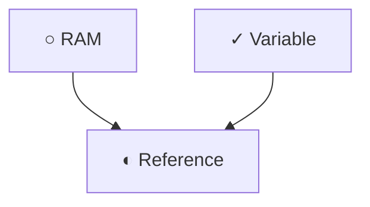

# Topic map

Before explaining anything in depth, the learner needs to know where they stand, where they are heading, and which pieces sit along the way. This skill builds that map. Speak following the `teacher-voice` skill.

## What it produces

A folder `learning/<topic>/` (topic name in lowercase with hyphens) containing:

- `map.md`: the one-sentence idea, the nodes with their prerequisites, and the suggested route.
- `glossary.md`: terms of the topic (starts with very few).
- `session.md`: where the learner is right now (used by `prerequisite-descent`).

It also produces the conversation itself, where the map is presented in a friendly way.

If the agent cannot write files, deliver the content of each file in a code block so the learner can save it.

## Steps

### 1. Understand the goal (two questions at most)

Ask what they want to learn and what for. The "what for" changes the map: learning Python to automate spreadsheets is not the same as learning it to train models. If they already said it, do not ask again.

### 2. Short diagnostic (optional)

Offer 3 to 5 quick questions, from broad to specific, to place their level. The learner may skip it, in which case the level is found out step by step with an "already know this?" check at each level of the descent.

Diagnostic rules:
- One question per message.
- Questions like "explain in your own words" or "what do you think happens if", never memorized definitions.
- At the end, summarize the detected level in a sentence or two and ask for confirmation.

### 3. Build the map

Respect mental load: 5 to 9 items per level. If more come out, group them.

- **The idea in one sentence.** Plus an everyday analogy for the central idea.
- **Layer 1: the pillars.** Between 5 and 9 big blocks of the topic.
- **Layer 2: subtopics** of each pillar, only as deep as it helps orientation.
- **Prerequisites.** For each node, which other nodes it depends on (`requires`). Include prerequisites that sit outside the topic (for example "RAM" inside "variables"), marked `external`.
- **Suggested route.** A sensible order that respects dependencies, with a "start here" marker based on the diagnostic.
- **Starter glossary.** At most 10 terms, only the ones the first layer will use, each in one line and in simple words. The full glossary grows later, when terms appear that the learner does not know. Do not build long glossaries up front, because they become another wall.

### 4. Diagram

Include a Mermaid diagram (`flowchart TD`) with the pillars and their dependencies, at most 15 nodes. If the topic is bigger, make one overview diagram and one per pillar. Mark each node's status with Mermaid classes (`classDef`) and do not rely on color alone: the node text should include a short status symbol (for example ○ todo, ◐ in progress, ● understood).

Present the diagram with a real sentence before it ("This is the whole terrain, from the top down") and one after it that connects it to the starting point.

### 5. Confirm before descending

Show the map and ask whether anything is missing, anything is extra, or the order makes sense. Then offer two or three entry points and let the learner choose where to start. Once they choose, move to the `prerequisite-descent` skill. If they ask for a clickable view, move to `interactive-explorer`.

## Format of `map.md`

````markdown
---
topic: python-variables
title: Variables and references in Python
goal: Understand why copying a list sometimes changes the original
created: 2026-10-25
starting_level: beginner
---

# Variables and references in Python

## The idea in one sentence
A variable is a name that points to a value stored in memory.

## Analogy
A label stuck on a box. It falls short when two labels point to the same box.

## Nodes

```yaml
- id: memory
  name: RAM
  summary: Where the computer keeps data while it works. It is erased when powered off.
  status: todo
  requires: []
  external: true
- id: variable
  name: Variable
  summary: A name tied to a value.
  status: known
  requires: []
- id: reference
  name: Reference
  summary: The address where the value lives in memory.
  status: in-progress
  requires: [memory, variable]
```

## Diagram



## Suggested route
1. RAM (external)
2. Variable
3. Reference
4. Mutable and immutable
````

### Valid node statuses

- `todo`: not touched yet.
- `in-progress`: being worked on now.
- `known`: the learner already knew it before (found by the diagnostic or by their own answer). This is the "floor" of the descent.
- `understood`: they rebuilt it in their own words in this session.
- `mastered`: it survived a spaced review of 7 days or more (set by `check-and-review`).

## Format of `glossary.md`

```markdown
---
topic: python-variables
---

- **reference**: the address where a value lives in memory. (seen in: reference)
- **mutable**: can be changed without creating a new value. (seen in: mutability)
```

One line per term, in words the learner would use. If a definition needs another word the learner does not know, that word also goes into the glossary.

## Initial format of `session.md`

```markdown
---
topic: python-variables
updated: 2026-10-25
---

## Stack
1. reference (in-progress)

## Parked
(empty)

## Next step
Go down to RAM if the learner asks for it.
```

## If `learning/<topic>/` already exists

Do not recreate it. Read `map.md` and `session.md`, summarize in two sentences where the learner left off, and ask whether to continue from there or adjust the map. If the map needs changes, edit it in place and keep the statuses already earned.
